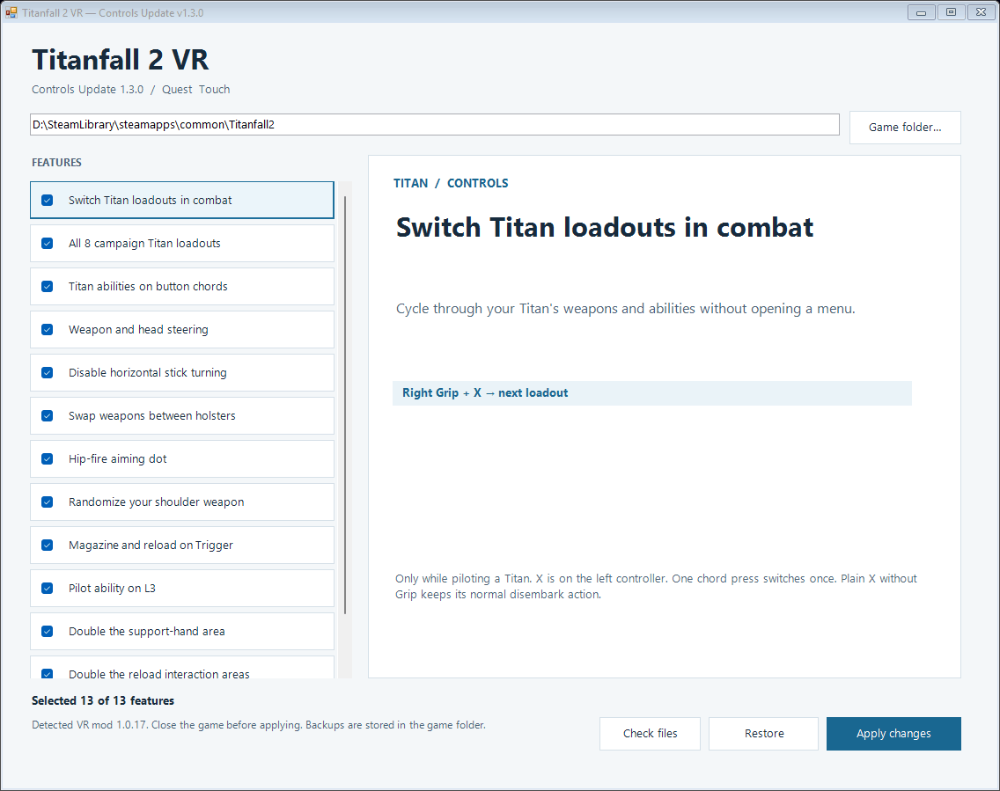
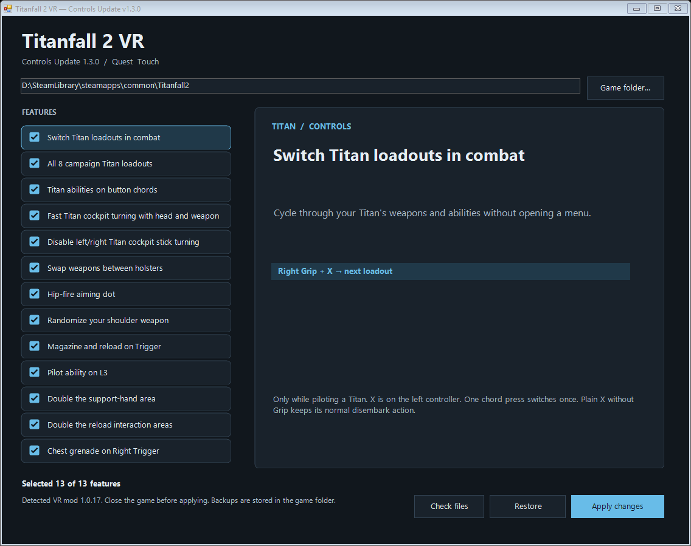

# Titanfall 2 VR — Controls Update v1.3.0

Unofficial Windows patcher for CircuitLord’s Titanfall 2 VR mod. Choose features on the left and see instructions and controls on the right.

## Download

[Download the EXE or ZIP](https://github.com/vikaquest/Titanfall2-VR-Controls-Update-EN/releases/latest)

## Install

1. Install Titanfall 2, then install the VR mod through [CircuitLordVRModInstaller](https://github.com/CircuitLord/CircuitLordVRModInstaller).
2. Close the game. Download and run `Titanfall2VR-QuestPatch.exe`.
3. Select the `Titanfall2` game folder. All options start enabled; uncheck any you do not want. Click a feature title to read its description and controls.
4. Click **Apply changes**, then launch VR through the original installer as usual.

Windows 10/11 x64, .NET Framework 4.8, Quest / Touch controllers. No Python, internet access or separate patcher installation is needed to run the EXE.

New features target the verified **VR mod 1.0.17** build. The earlier **1.0.13 / 1.0.14** profiles retain their previous nine options and mappings. Files are recognized by hashes, not just version labels.

## Application preview

The animation selects the next feature every second. This shows the real application UI, not gameplay.

Static screenshot

## Features and controls

### Switch Titan loadouts in combat

Cycle through your Titan's weapons and abilities without opening a menu.

- Right Grip + X → next loadout

Only while piloting a Titan. X is on the left controller. One chord press switches once. Plain X without Grip keeps its normal disembark action.

### All 8 campaign Titan loadouts

Include campaign loadouts that have not yet been unlocked by the story.

- Right Grip + X → cycle loadouts
- Expedition · Tone · Scorch · Brute
- Ion · Ronin · Northstar · Legion

Available once you are piloting a Titan; this does not spawn a Titan during the first mission's on-foot section. Menu locks and story progress remain unchanged. Level resource availability can limit selection.

### Titan abilities on button chords

Hold Left Grip and press a button to use an ability. No directional hand gestures are required.

- Left Grip + Left Trigger → ability 1
- Left Grip + A → ability 2
- Left Grip + B → ability 3
- Left Grip + R3 → Titan core
- Left Grip + Right Trigger → melee
- R3 without Grip → melee

A and B are on the right controller. R3 means clicking the right stick. Ability 1 supports holding. VR 1.0.13 / 1.0.14 retain their earlier mapping; the updated chords apply to 1.0.17.

### Fast Titan cockpit turning with head and weapon

The weapon contributes 70% of the cockpit's target heading and your head contributes 30%. Turning is faster, with a brief inertial follow-through.

- Weapon — 70%   /   Head — 30%
- Automatic turn rate — up to 360°/s
- Transient inertial lead — up to 20°

Also reduces sword-defense transitions and recovery settings to 0.1 s. If the weapon pose is invalid, steering falls back to the headset. Stick turn speed is doubled when stick turning is enabled.

### Disable left/right Titan cockpit stick turning

Disable artificial left/right turning with the right stick, both on foot and in a Titan. Use physical VR movement instead.

- Right stick left / right → no virtual turn

Vertical stick input and stick clicks are preserved. Enable weapon/head steering above to steer the Titan cockpit using tracked motion.

### Swap weapons between holsters

Swap the weapons stored behind your shoulder and at your left hip. Both stay holstered rather than being drawn into your hands.

- B → swap holstered weapons

Both weapons must be holstered, hands empty, and other buttons released. B is on the right controller. With a weapon in hand, B retains normal reload behavior.

### Hip-fire aiming dot

See where your weapon is pointing without bringing it up to your eye or entering the aiming view.

- Small, solid white dot
- Shown while the pilot holds a weapon

This indicates weapon direction, not bullet spread or a predicted trajectory. It is not shown for grenades or Titans.

### Randomize your shoulder weapon

Replace the weapon in your shoulder holster with a random weapon. Your left-hip weapon stays unchanged.

- Right Trigger + B → random weapon
- Press B again for another replacement

Both weapons must be holstered and your hands empty. The 31-weapon pool is filtered by level resource availability and excludes your current weapons. Requires the holster-swap option.

### Magazine and reload on Trigger

Use the left trigger to grab magazines and operate manual reload mechanisms. Grip remains available for holding the weapon.

- Left Trigger → magazine and reload

Automatically enables moving the pilot ability to L3 to free the left trigger.

### Pilot ability on L3

Activate cloak or the pilot's current ability by clicking the left stick.

- L3 → pilot ability

Applies on foot. L3 means clicking the left stick. Frees the left trigger for reload interactions.

### Double the support-hand area

Double the interaction area used when supporting your weapon with the second hand.

- Support-hand grab area ×2

Does not change the right-Grip weapon-draw area.

### Double the reload interaction areas

Double magazine and reload-mechanism interaction areas so controller movements require less precision.

- Magazine and reload-mechanism areas ×2

Changes interaction areas, not the speed of reload animations.

### Chest grenade on Right Trigger

Bring your hand to your chest and press the right trigger to grab a regular grenade.

- Hand at chest + Right Trigger → grenade

Applies to regular grenades. C4 pickup changes are not included.

## Backups and changing options

All options are checked on each launch, regardless of the previous selection. Review them before applying. The normal loadout-cycle option and all-eight option may both be checked; all-eight expands the available cycle. Reload-on-Trigger enables the pilot-ability remap; random weapons require holster swapping.

The patcher rebuilds files from verified baselines rather than stacking edits. Unchecking all options returns supported files to their baseline. **Restore** uses the original backup journal. Existing 1.0.17 journals and our current manual modifications are supported.

Backups and journals live inside the game folder in `.quest-custom-patch`, `.quest-custom-patch-1.0.14` or `.quest-custom-patch-1.0.17`. Keep these folders. Do not run an older patcher over 1.3.0.

## Source and build

This repository contains the patcher source, not the original VR mod source.

- `QuestPatch.cs` — UI, installer, verification and recovery.
- `features.json` — feature descriptions, instructions and display order.
- `messages.json` — English translations of installer messages.
- `payload.json` — binary patch operations, script deltas and supported-file hashes.
- `build.ps1` — standalone x64 .NET Framework build.

Run `./build.ps1` on Windows. The result is `dist/Titanfall2VR-QuestPatch.exe`. No original game DLLs or complete original game scripts are included.

## Verification and limits

See [VERIFICATION.md](VERIFICATION.md). The installer was checked on isolated copies, including the 8192 feature combinations, apply/restore and upgrade from the current manual installation. UI dependencies, both language builds and the 13-frame GIFs were checked. These checks do not replace playing in a VR headset.

Level resources and saved state can limit available loadouts or random weapons. C4 pickup, dual wielding, slide prototypes, late server-console loading, automatic recenter on embark and the cosmetic disembark weapon fix are not included. The aiming dot does not predict bullet spread.

## Credits

Original Titanfall 2 VR mod and installer: [CircuitLord](https://github.com/CircuitLord/CircuitLordVRModInstaller). This is a separate, unofficial campaign add-on, not an official CircuitLord release.
